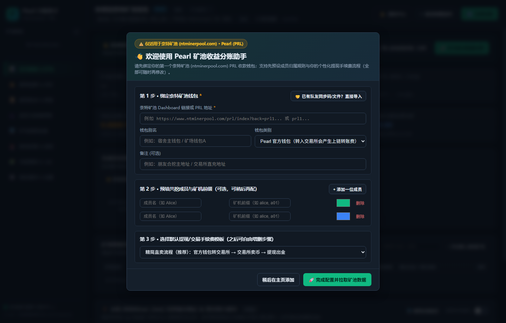
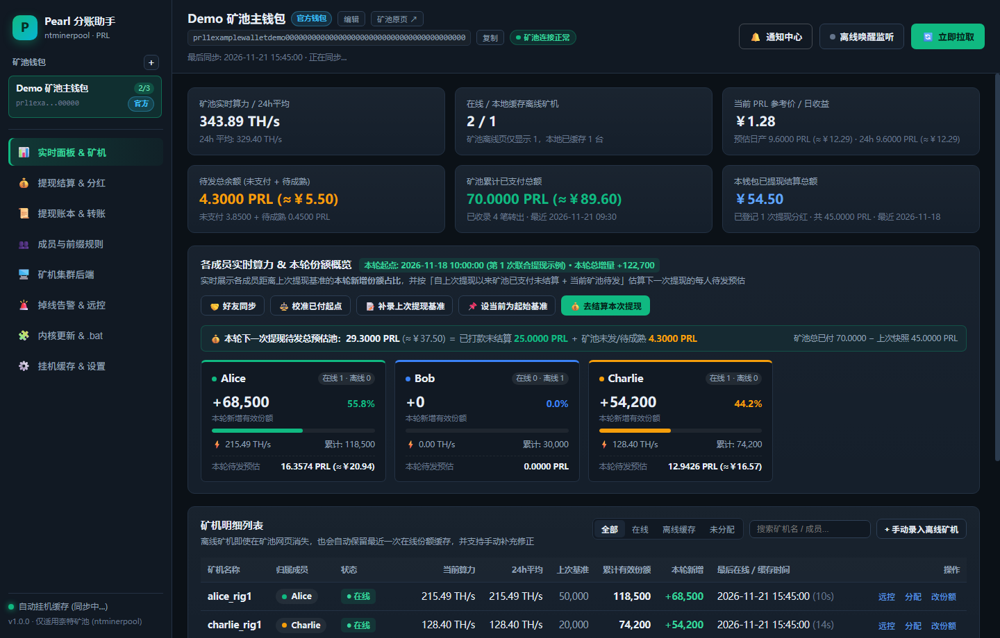
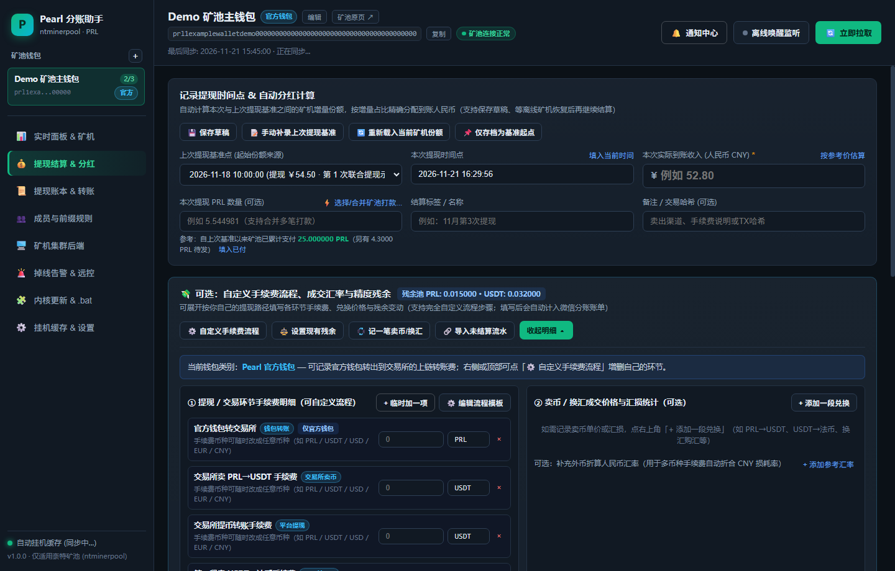
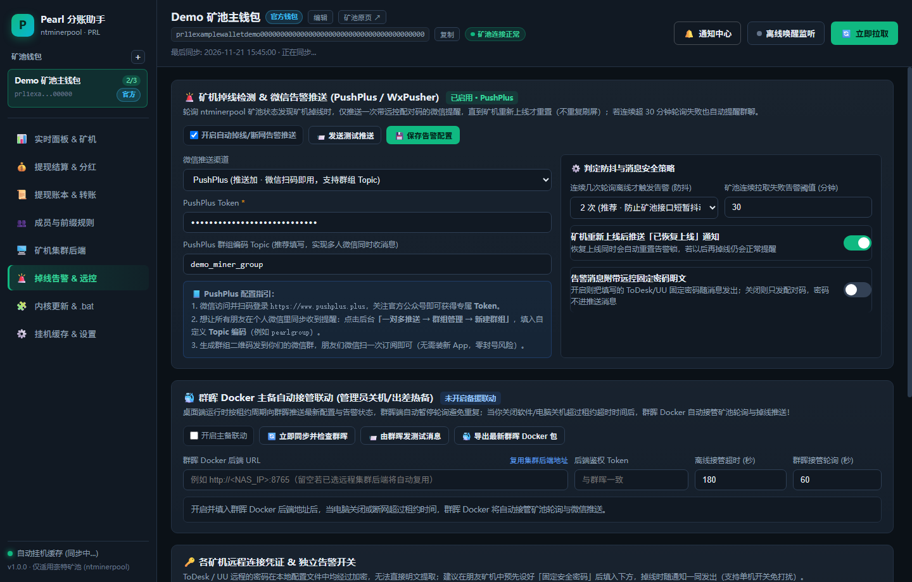
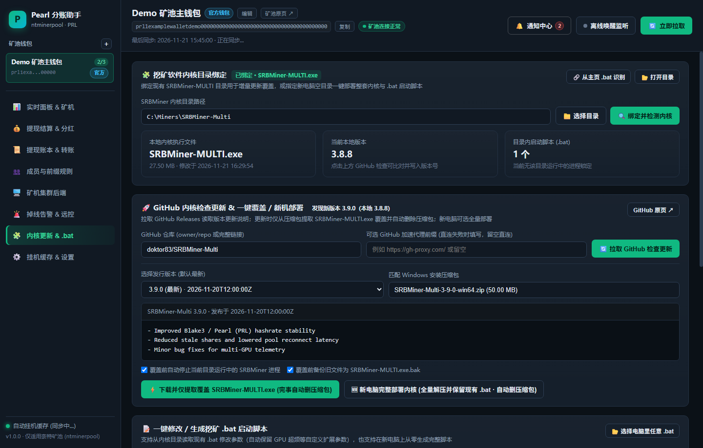
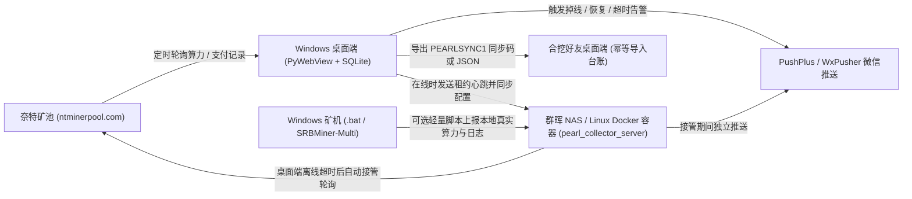

# Pearl Wallet Splitter（奈特矿池 Pearl 收益分账与运维助手）


%20Only-10b981)


面向多人合伙合挖 **Pearl (PRL)** 的桌面端自动化分账、掉线推送与内核运维工具。支持**本地离线份额缓存防丢、完全自定义提现手续费流水线、微信掉线告警 + 远程配对码推送、群晖 NAS / Linux Docker 主备热切换**，以及 **SRBMiner-Multi 内核一键更新与 `.bat` 生成**。

> [!IMPORTANT]
> **适用范围说明：本工具仅适用于奈特矿池（[ntminerpool.com](https://www.ntminerpool.com)）Pearl (PRL) 算力池。**
> 页面解析器与支付流水采集均针对奈特矿池 HTML 结构与接口定制，不支持其他矿池或其他币种。

---

## 核心功能展示

### 1. 首次启动引导与零门槛初始化

全新安装启动时无任何预设个人地址或硬编码名单，通过向导即可在 30 秒内完成初始化，也可通过「好友同步码 / JSON 文件」一键导入合伙人发来的矿池钱包与历史提现台账：



- **仅需 1 个奈特矿池 PRL 地址或 Dashboard 链接** 即可开始自动监控；
- **可选预填共挖成员与矿机前缀**（如 `alice` 自动归类 `alice_rig1`、`alice_02`）；
- **内置多种手续费流程预设**（`精简直卖流程` / `多段换汇转账流程` / `空白自定义`），进入软件后仍可随时增删改。

---

### 2. 实时算力看板、离线份额缓存与本轮待发预估

奈特矿池的在线矿机一旦掉线超过展示窗口，就会从网页端「在线矿机表」短暂消失，导致直接抓取页面算分账时漏算份额。本工具通过本地 SQLite 持续快照，彻底解决掉线丢份额痛点：



- **自动保留离线矿机最后有效份额**：即使矿机已从矿池首页消失，本地仍保留其最后一次同步的累计份额（支持手动微调或补录）；
- **按“上次提现基线 -> 下一次提现”动态预估待发收益**：结合「自上次提现以来矿池已支付增量 + 当前矿池未支付/待成熟余额」，按本轮增量份额占比实时折算每人待分 PRL 与人民币估值（`CNY`）；
- **队友一键同步**：房主提现后可导出加密压缩文本 `PEARLSYNC1:...` 或 `.json` 文件，合挖好友导入后即可幂等更新历史提现记录，免去手动对账。

---

### 3. 提现结算分红与完全自定义手续费流水线

每个人的出金路径都可能不同（链上直转、多交易所转币、跨币种兑换、法币换汇或直接 OTC）。结算引擎全面采用**动态多段流水线模型**：



- **自由定制手续费模板**：在「自定义手续费流程」或模板编辑器中自由添加、删除、拖拽调整顺序、修改每一步名称、分类（`钱包转账` / `交易所卖币` / `法币出金` / `其他`）及币种（`PRL` / `USDT` / `USD` / `EUR` / `CNY` 等）；
- **智能钱包类别识别**：标记为「Pearl 官方钱包」的地址自动显示并允许填写链上转入交易所的手续费，交易所直充钱包则自动跳过该项；
- **多段卖币换汇与市场损耗计算**：可记录分批挂单或分段换汇价格与参考汇率，真实反映全链路实际到账损耗率；
- **多币种残余校准**：自动累计或消耗每次交易所挂单因最小下单精度造成的微量残余（PRL / USDT / 自定义币种），支持随时手动校准当前账户残余基数；
- **一键生成微信分账账单**：自动汇总每人实得金额、本轮增量份额、占比、已填手续费与汇率损耗，复制后可直接发送合伙人微信群。

---

### 4. 矿机掉线微信告警 & 群晖 NAS Docker 主备热接管

无需在每台矿机上部署额外监控软件，只需桌面端轮询奈特矿池接口即可检测掉线；同时配套轻量级标准库 **Docker 后端服务**，确保主机关机或出差时依然 24 小时守护不漏报：



- **防抖 + 防重复刷屏**：支持配置「连续 N 次轮询确认掉线才告警」，每台掉线机器仅发送 **1 次** 提醒；待其重新上线后自动推送恢复通知并重置告警锁；
- **连续轮询失败超时提醒**：若因网络或矿池接口波动导致连续超过设定时间（默认 30 分钟）拉取失败，自动推送预警提示人工关注矿机状态；
- **附带远程控制配对码**：支持预设 `ToDesk` / `UU远程` / `RustDesk` 等工具配对码与备注，掉线消息中自动携带对应矿机联系方式（明文密码默认关闭，可按需开启）；
- **零封号风险推送通道**：支持 **PushPlus**（支持扫码加入个人群组 Topic，多人微信同时收通知）与 **WxPusher** 官方公众号推送；
- **桌面端 ↔ 群晖 Docker 主备联动**：桌面端在线时定期发送租约心跳由桌面端负责推送；当桌面端关机超过租约超时时间后，群晖 Docker 自动接管轮询与微信告警，桌面端重新开机后平滑交回。

---

### 5. SRBMiner-Multi 内核更新、新机部署与 `.bat` 剧本生成器

专为 Windows 矿机端打造的安全挖矿内核维护工具：



- **GitHub Release 拉取与代理支持**：一键查询仓库最新版本、阅读更新日志、匹配 Windows 压缩包（支持填写 GitHub 加速代理前缀）；
- **精准提取覆盖**：更新时自动停止目标目录中运行中的 `SRBMiner-MULTI.exe`、备份旧文件为 `.bak`、**仅提取覆盖 `SRBMiner-MULTI.exe`** 并在完成后自动删除下载压缩包，完整保留现有超频与启动脚本；
- **新电脑全量部署与中文路径安全**：支持空目录一键解压整套内核，并内置 CP437 / UTF-8 中文压缩包文件名兼容修复以及 Windows `.bat` 启动脚本可视化编辑与生成。

---

## 系统架构示意图



---

## 快速开始

### 方式一：直接下载 Windows 独立安装包（推荐）

1. 前往本仓库 [Releases 页面](https://github.com/213LD/Pearl-Wallet-Splitter/releases) 下载最新版 `PearlSplit.exe`。
2. 放在任意独立文件夹（例如 `D:\Tools\PearlSplit\PearlSplit.exe`）双击运行，程序会在同级 `data\` 目录自动创建本地数据库。
3. 按照首次启动向导输入你的 **奈特矿池 PRL 钱包地址或 Dashboard 链接** 即可开始使用。

### 方式二：从源码运行与打包

环境要求：**Python 3.11+**（推荐 Windows 10 / 11，WebView2 运行时系统自带）。

```powershell
git clone https://github.com/213LD/Pearl-Wallet-Splitter.git
cd Pearl-Wallet-Splitter
pip install -r requirements.txt

# 启动桌面应用
python main.py

# 运行单元测试（28 项测试，含编码安全、自定义流水线、Docker 主备等）
python -m unittest discover -s tests -v

# 打包单文件 EXE（输出位于 dist\PearlSplit.exe）
powershell -ExecutionPolicy Bypass -File .\build.ps1
```

### 方式三：部署群晖 NAS / Linux Docker 后端（热备告警与矿机集群收集）

1. 从 Release 下载 `pearl_collector_server_docker.zip`（或直接在桌面端软件「矿机集群后端 / 掉线告警」页面一键导出最新 Docker 包）。
2. 将压缩包上传至群晖 `/docker/pearl-collector` 等目录解压。
3. **强烈建议**：编辑 `.env` 或 `docker-compose.yml` 中的 `COLLECTOR_TOKEN`，将默认占位符 `CHANGE_ME_STRONG_TOKEN` 修改为你自己的高强度随机密钥！
4. 在目录内执行：

```bash
chmod +x start_collector_server.sh
docker compose up -d --build
# 若 NAS 环境不方便现场构建，也可使用内置 python:3.11-slim 免构建启动：
docker compose -f docker-compose.nobuild.yml up -d
```

服务默认监听 `8765` 端口，提供 `/health`、内置轻量 Web 监控页、远程客户端遥测接入以及桌面端自动主备同步接口。

---

## 项目文件地图（File Map）

```text
Pearl-Wallet-Splitter/
├── main.py                      # 桌面端应用入口、单实例控制、托盘图标与后台线程生命周期管理
├── build.ps1                    # PyInstaller 单文件打包脚本（生成 PearlSplit.exe）
├── requirements.txt             # Python 依赖清单（pywebview / requests / bs4 / pystray / pillow）
├── LICENSE                      # MIT 开源许可证（Copyright (c) 2026 213LD）
├── assets/                      # 应用图标资产（pearl.ico / pearl.png）
├── docs/images/                 # README 展示用的脱敏界面截图（01~05 PNG）
├── pearl_split/
│   ├── __init__.py              # 包元信息与版本号（__version__）
│   ├── api.py                   # PyWebView JS-Python 通信桥接层（DesktopApi 所有前端接口）
│   ├── db.py                    # SQLite 数据持久化、多钱包/成员/结算台账、流水线模板、同步码与告警状态机
│   ├── calculator.py            # 增量份额分账算法（精确分币无误差）、自定义手续费汇总、多币种残余追踪
│   ├── scraper.py               # 奈特矿池（ntminerpool.com）HTML 抓取解析器与重试会话
│   ├── poller.py                # 后台定时轮询引擎、退避重试、桌面掉线检测与群晖主备租约同步
│   ├── alert_engine.py          # 零第三方依赖微信告警推送（PushPlus / WxPusher）与 stdlib 矿池解析器
│   ├── kernel_manager.py        # SRBMiner-Multi GitHub 更新检查、安全 ZIP 提取覆盖、中文文件名编码修复与 .bat 生成
│   ├── miner_binder.py          # 本地 Windows .bat 绑定启动、进程检测与控制台实时算力尾随
│   ├── srb_parser.py            # 零依赖 SRBMiner 控制台/日志解析器与 .bat 命令行分析器
│   ├── collector_server.py      # 独立 HTTP 服务端（矿机遥测汇聚、Web 状态页与 Docker 独立热备值守进程）
│   ├── collector_kits.py        # PowerShell/Docker 客户端及服务端一键部署包生成器（自动注入强鉴权配置指引）
│   ├── paths.py                 # 兼容源码运行与 PyInstaller 单文件运行时的资源与数据路径解析
│   └── web/
│       ├── index.html           # 单页应用骨架、首次引导向导及各功能模块视图
│       ├── styles.css           # 深色工业风 UI 样式、响应式卡片与抽屉/弹窗层叠样式
│       └── app.js               # 前端交互逻辑、动态手续费模板编辑器、状态轮询与通知中心
└── tests/
    └── test_core.py             # 28 项单元测试（分账、离线缓存、同步码、自定义手续费、安全加固、Docker 包等）
```

---

## 注意事项与隐私安全说明

1. **单矿池限制**：本项目强绑定 **奈特矿池（ntminerpool.com）PRL 页面格式**。如果矿池未来大幅改版前端 DOM 结构，需同步更新 `pearl_split/scraper.py` 与 `pearl_split/alert_engine.py`。
2. **离线份额与基线校准**：若合挖某台矿机在两次结算中间长时间掉线且未能被桌面端轮询捕获，可在结算页面使用「手动补充离线矿机」或「手工修改份额」修正后再执行分账。
3. **远控密码与 Token 安全**：
   - 在「掉线告警」页面中，「告警消息附带远控固定密码明文」**默认关闭**，建议优先仅推送设备配对码，确保敏感密码不会进入第三方推送消息体；
   - 部署 Docker 后端时务必将 `COLLECTOR_TOKEN` 替换为强随机密钥，不要直接暴露在公网无 HTTPS 环境下使用默认口令；
   - 数据库文件 `pearl_split.db` 仅保存在本地 `data/` 目录（Docker 端保存在挂载卷 `collector_data/`），**请勿将个人数据库上传至公开仓库**（已在 `.gitignore` 中默认排除）。
4. **软件免责声明**：本工具仅作为开源矿池数据辅助统计与运维通知软件使用，涉及的币价估值、手续费损耗与分账结果请以链上实际到账和合挖成员协商为准。

---

## 开源许可

本项目采用 [MIT License](LICENSE) 开源许可协议发布。
